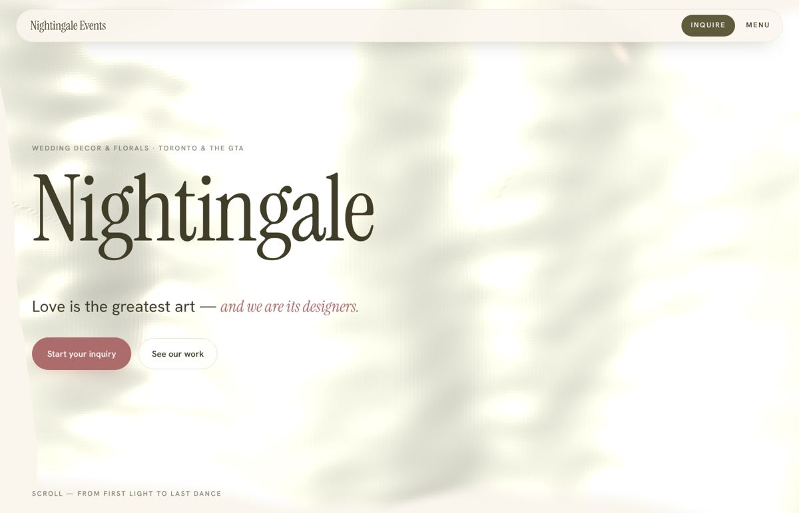
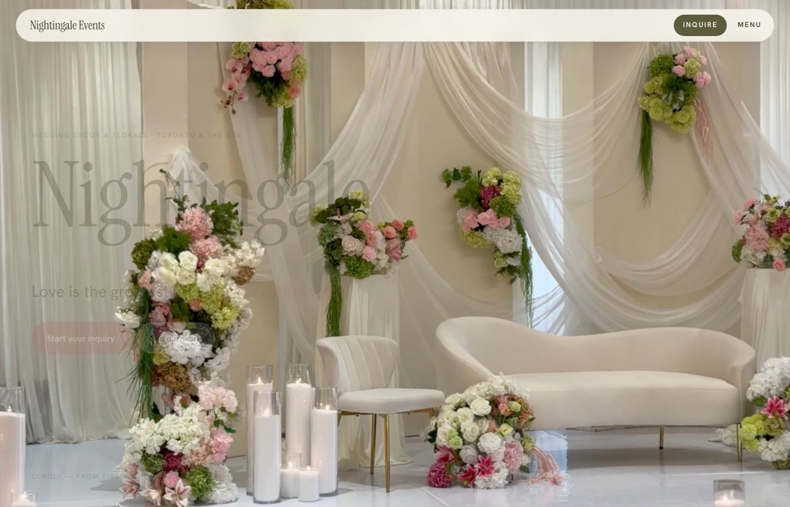
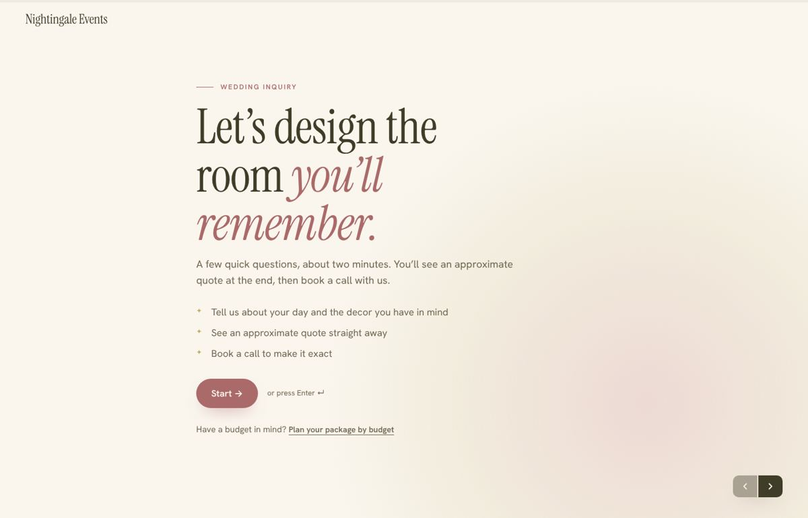
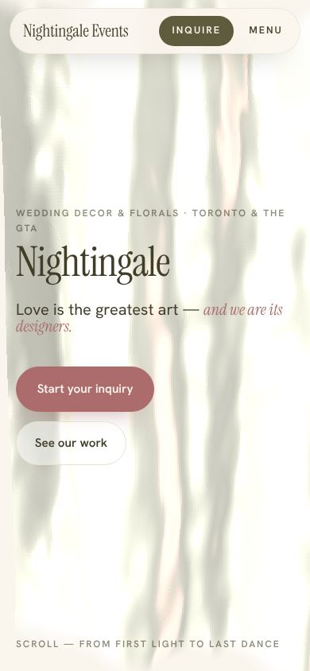
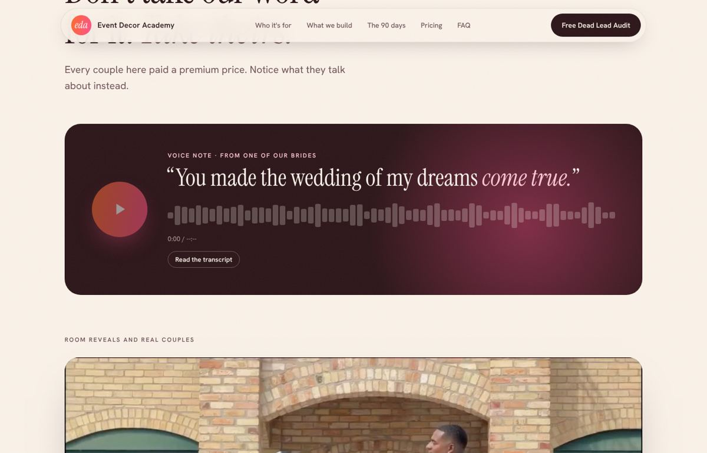
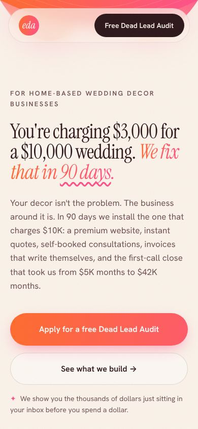
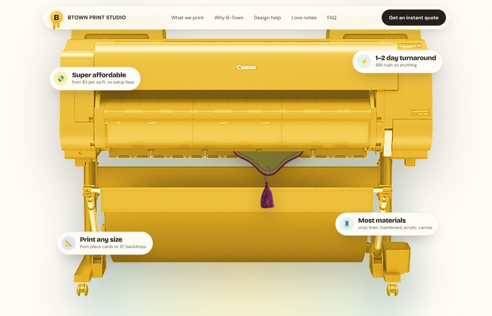
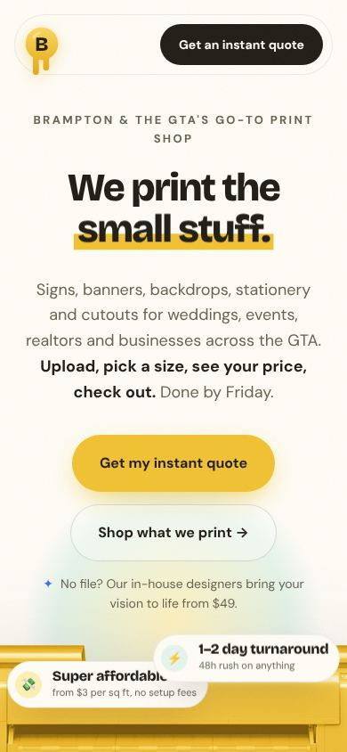

# Case studies

Three shipped sites, grouped by industry and by what the site had to *do*. Each entry records the brief, the decisions, what the owner reacted to, and screenshots by section. Start with the one closest to the new client.

Screenshots are in `../assets/screenshots/`.

---

## Nightingale Events: wedding decor and florals (service, sold on taste)

**Live:** https://nightingaleevents.ca · **Source:** `awardwinningsites/nightingale-events/`
**Job of the site:** make a home-based decor studio look like the premium option in Toronto, then route couples into a budget planner or a one-question-at-a-time inquiry.

### Decisions
- **Type:** Instrument Serif at 400 for display, italics in rosewood for the accent phrase, Hanken Grotesk body. A Fraunces variable base layer exists in the compiled CSS; the theme overrides it with Instrument Serif.
- **Palette:** blush and pistachio on ivory. Moss (#5d593c) for depth, rosewood (#ab6a6a) for accent, linden (#beb06c) as the warm green.
- **Hero:** a WebGL silk curtain that parts as you scroll to reveal a real room-setup video underneath. Hero copy fades out as the room takes the stage. Preloader counts up before it.
- **Flow:** hero, budget planner band, manifesto with three staggered photo frames, italic marquee, love notes (voice note, reveal videos, chat bubbles), staggered gallery of looping clips, behind-the-scenes arches, olive footer.
- **Inner pages are calm.** No silk, still hero, each section in one colour.
- **Conversion tools:** Plan by budget (slider, guest count, drag priorities, live package and estimate) and Inquire (one question per screen, keyboard driven). Both share one pricing module so the math never diverges.

### What the owner loved
The silk reveal, the love notes in their native chat styling, and the budget planner. The planner is the single biggest driver of qualified calls.

### Screenshots
| Section | File |
|---|---|
| Hero, silk |  |
| Hero, room revealed on scroll |  |
| Budget planner band |  |
| Manifesto + frames |  |
| Love notes: voice note |  |
| Love notes: chats |  |
| Gallery |  |
| Behind the scenes arches |  |
| Plan by budget tool |  |
| Inquiry flow |  |
| Mobile |  |

---

## Event Decor Academy: coaching offer, high-ticket sales page

**Source:** `awardwinningsites/event-decor-academy/` · not deployed at time of writing
**Job of the site:** sell a $4,997 90-day program to home-based decorators and qualify them through a free "Dead Lead Audit" application.

### Decisions
- **Type:** Instrument Serif + Hanken Grotesk again, but louder: gradient text on the hero punchline, a hand-drawn squiggle under the key phrase.
- **Palette:** paper (#fbf3ea), ink (#2b1418), an orange-to-pink gradient as the single accent. The gradient is the brand.
- **Hero:** animated SVG silk drape across the top, arch-framed install photo with two floating stat badges that bob, proof bar of three serif numbers with count-up.
- **Sales structure (in order):** hero, marquee, who it's for (ticks vs crosses), same wedding different price (dashed "them" card vs rotated dark "you" card), founder story with stats, what we build (six numbered steps with tags), 90-day timeline as one-open-at-a-time modules, love notes, value stack as a receipt with dotted leaders and a strikethrough total, guarantee seal, FAQ, dark final CTA with glow.
- **Conversion tool:** one-question application with keyboard nav, draft saved to localStorage, conditional copy that uses earlier answers ("Nice to meet you, Sara").

### What the owner loved
The receipt-style value stack and the chat-bubble love notes. Both were lifted into Nightingale afterwards.

### Screenshots
| Section | File |
|---|---|
| Hero with drape, arch, badges |  |
| Who it's for |  |
| Same wedding, different price |  |
| Founder story |  |
| What we build |  |
| 90-day timeline modules |  |
| Love notes: voice note |  |
| Value stack receipt |  |
| FAQ |  |
| Final CTA |  |
| Application flow |  |
| Mobile |  |

---

## B-Town Print Studio: large format print shop (physical product, e-commerce-leaning)

**Source:** `NightingaleEvents/btown-print-studio/` on branch `claude/eloquent-ride-bx8b6w` · deployed to https://btownprintstudio.netlify.app
**Job of the site:** stop the email-for-a-quote cycle. Clients upload artwork, pick a size, see the price and a real-size preview, and check out.

### Decisions
- **First draft was wrong on purpose-to-learn:** it reused the EDA template (serif, drape, arch) and the owner said it looked like "a copy of EDA" and "our software product". A physical product needs different energy.
- **Type:** Bricolage Grotesque at 800 for display, DM Sans body. Headline accents are a yellow marker highlight instead of italics.
- **Palette:** from the Pantone board and logo. Sunshine yellow primary (#f2c230), aquatic mint (#b7e3d1) secondary, a touch of blue (#3d6eeb) for kickers, step numbers, focus states and the silhouette.
- **Hero:** big centred headline "We print the ___" rotating through the top-selling categories (clean vertical swap, outgoing word fully gone before the next arrives), then the shop's own large format printer at near full width, recoloured to brand yellow, printing the client's real signs in a constant 1.5 s loop. Five floating claim bubbles around it (affordable, turnaround, any size, materials, reviews). No drape, no arch.
- **Logo mark:** honey-drop B with two drips, built in SVG to echo the dripping logo.
- **Conversion tool:** instant quote. Upload with live preview, who's ordering (customer $5 / sq ft, vendor $3 / sq ft), product, size presets or inches, quantity with volume tiers, 48h rush, live total and per-piece. Beside it a real-size preview scaling the artwork next to a 5'5" silhouette with grommets and a "1.5× taller than a person" readout.
- **Sections:** hero, brands marquee (two counter-scrolling rows of sample wordmarks across industries), instant quote, product gallery with "from" pills, why us as sticky split, design-help modules, love notes with Google review cards, "what we do" flip cards with real photos, service area, FAQ, dark final CTA.
- **Owner's edits, verbatim:** remove the pulsing dot; remove the ribbon; make the swap purely vertical; loop the printer instead of scroll-scrubbing it; "he looks sad" then "insanely lanky" then "squeeze 20%" on the silhouette; replace emoji with real photos; "If you can think it, we can print it."

### Screenshots
| Section | File |
|---|---|
| Hero, rotating headline |  |
| Printer loop with claim bubbles |  |
| Brands marquee |  |
| Instant quote + real-size preview |  |
| Product gallery |  |
| Why us, sticky split |  |
| Design help modules |  |
| Love notes with Google cards |  |
| What we do, flip cards |  |
| Flip card hovered |  |
| Service area |  |
| Final CTA |  |
| Mobile |  |

---

## Picking a starting point by industry

| New client | Closest site | Carry over | Change |
|---|---|---|---|
| Decor, florals, planners, photographers, venues | Nightingale | Serif + italics, silk or video-reveal hero, love notes, gallery, budget planner | Palette, the planner's price table |
| Coaching, courses, consulting, any high-ticket offer | EDA | Sales-page order, who-it's-for, price comparison, receipt stack, application flow | Gradient colours, numbers, guarantee |
| Print shops, bakeries, rentals, retail, anything you can hold | B-Town | Chunky type, product-as-hero, instant quote, product grid, flip cards, brands row | Palette, the quote math, the hero object |
| Realtors, mortgage brokers, law, dental, local services | Mix: EDA proof + B-Town tools | Proof bar, Google review cards, FAQ, service-area SEO, a calculator | Tone down playfulness; serif or clean grotesque per brand |
