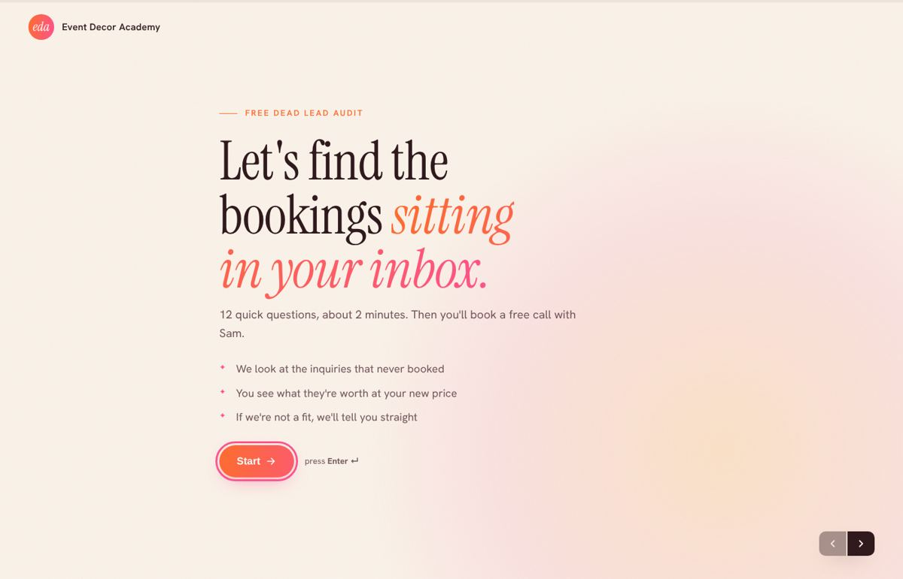
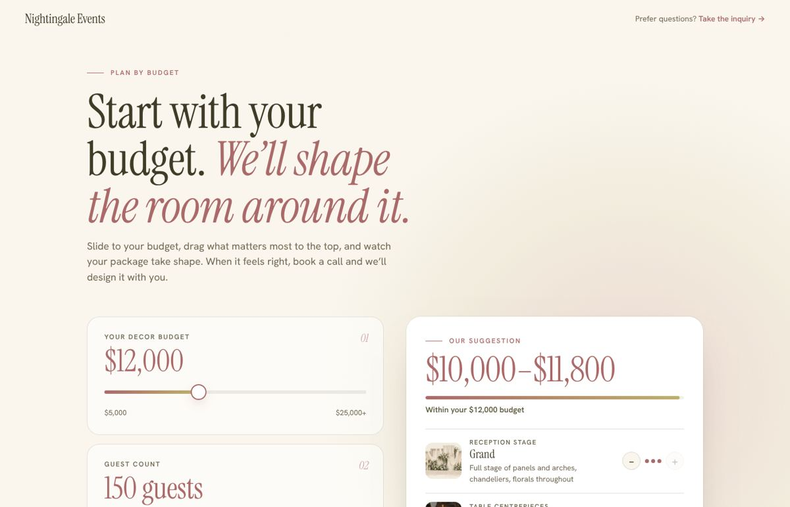
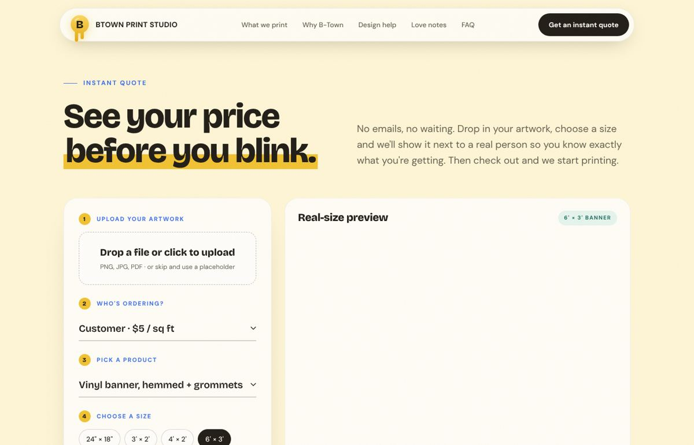

# Conversion tools

Every site has one self-serve tool that replaces an email thread. It is the part the owner shows their friends. Build it in the first draft, with visible placeholder numbers, and swap in the owner's real rates when they arrive.

## 1. One question at a time (EDA Apply, Nightingale Inquire)

A full-screen flow: one question per screen, big serif question with an italic turn, options as pill or tile buttons, text inputs as serif text on a bottom rule, prev/next arrows bottom-right, Enter to advance, a thin gradient progress bar at the top, draft saved to localStorage.

Why: it feels like a conversation, completion rates beat a long form, and it qualifies while it collects. Copy adapts to earlier answers ("Nice to meet you, Sara. What's your business called?").

Structure of a question:
```js
{ id:"weddings", type:"single", title:()=>"How many weddings have you decorated so far?",
  options:["None yet","1 to 4","5 to 10","11 to 25","More than 25"] }
{ id:"business", type:"text", required:true, title:a=>`Nice to meet you, ${esc(a.name||"friend")}. <em>What's your business called?</em>`,
  help:"Add your Instagram handle or website too." }
```
Types used: `text`, `single`, `multi` (with an "Other" free text), `number`, `date`. End screen: summary, a booking embed (Calendly) if qualified, else a kind "not a fit" message. Submit as JSON to a webhook (`FORM_ENDPOINT`) and mirror the fields in a hidden Netlify form so the host also captures it.

Key CSS: `.qf__q{font:400 clamp(32px,4.4vw,52px)/1.08 var(--serif)}`, `.qf__input{font:400 clamp(26px,3.2vw,38px) var(--serif);border:0;border-bottom:2px solid rgba(0,0,0,.2)}`, panels animate in from the right (`translateX(60px)`) and back from the left; a shake keyframe on validation error.



## 2. Plan by budget (Nightingale)

Left column of numbered cards: budget slider ($5k to $25k+), guest count slider, florals choice, then draggable priority list. Right column, sticky: "Our suggestion" with a price range, a gradient progress bar against the budget, and one row per priority with a thumbnail, tier name, hint and ± steppers to fine-tune. A "book a call" CTA submits the configuration.

Why: couples arrive with a number and no vocabulary. Letting them rank priorities and watch the package rebuild teaches them the trade-offs and pre-sells the consult.

Logic: each priority has levels 0..max with a label, hint and price. Allocate the budget by upgrading the top priority first, then the next, until the budget is spent. Estimate and `money()` formatting live in one shared module imported by both the planner and the inquiry so the math never diverges.



## 3. Instant quote with real-size preview (B-Town)

Left panel, five numbered steps: upload (drag or click, image previews immediately on the banner, PDF shows "we'll proof it"), who's ordering (customer vs vendor rate), product, size (preset chips plus width and height in inches on serif inputs), quantity stepper and a rush toggle. A dark price box with the total in brand colour, a meta line showing the math, per-piece and ETA, then the checkout button.

Right panel: the artwork scaled next to a 5'5" silhouette on a floor line, with dimension pills, grommets drawn for banner products, and a readout like "1.5× taller than a person". Scale so both fit: `scale = min(availH / max(65, H), availW / (W + 20))`.

Why: most people cannot picture 7×3 versus 5×2. The silhouette turns a number into a feeling and stops under-ordering.

Pricing as shipped (owner's numbers):
```js
const rate = +who.value;               // 5 = direct customer, 3 = vendor or planner, per sq ft
const sqft = (W * H) / 144;
let unit = sqft * rate;
const disc = Q>=50?.8 : Q>=20?.85 : Q>=10?.9 : Q>=5?.95 : 1;   // volume tiers
let total = unit * disc * Q;
if (rush.checked) total *= 1.3;        // 48h rush
```
Keep product minimums or per-material rates out unless the owner asks; they said "square footage times three or five" and meant it.

Silhouette lessons from the owner: keep the head centred, no stray foot rectangles, torso should flow into the legs in one line, legs shorter than the torso, and when you shorten the body shrink the viewBox so the figure still maps to 5'5" against the preview.



## 4. Smaller tools worth adding when they fit
- **Delivery date readout** that updates with rush and quantity ("Ready by Thu Oct 23").
- **Upload quality check** warning when the file is too low-res for the chosen size.
- **Occasion presets** that preload product and size ("Wedding welcome sign", "Trade show banner").
- **Trade pricing toggle** for planners and realtors.
- **Hidden Netlify form** mirroring every field so submissions land in the dashboard even before a webhook exists.

## Checkout and backend
Samples ship with a demo alert on "Add to cart". For production: Stripe Checkout or Shopify Buy Button for payment, file uploads to object storage with a size and type check, and an order status page (Proofing, Printing, Ready). Keep the quote math on the client for instant feedback and recompute it on the server before charging.
